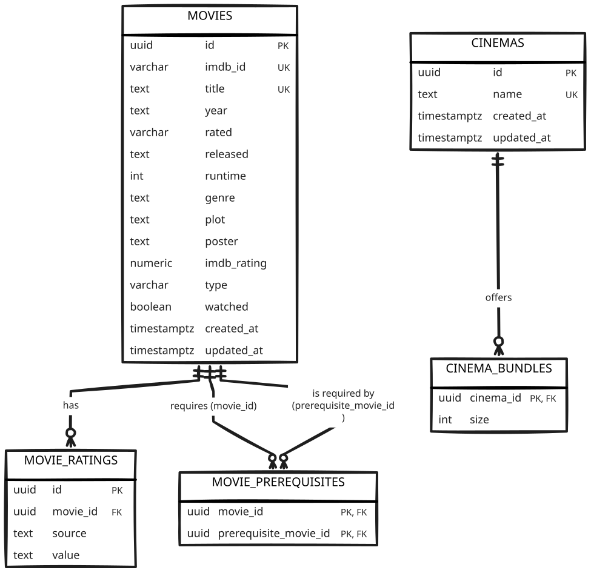

# Doomsday Ready

This is a full-stack application which is aimed to assist the MCU fans plan their marvel movie rewatch before watching *Avengers: Doomsday* and book a watch party in cinemas.

- **Frontend:** React (Vite), served by nginx
- **Backend:** Node.js, Express, TypeScript
- **Database:** PostgreSQL (PostgreSQL 16 Docker Image)

## Quick Start

To run the project - 

```bash
docker compose up -d --build
```

**After running docker command above, visit - `http://localhost:5173`**

| Service | Container port | Host port | Access |
|---|---|---|---|
| Frontend (nginx) | 80 | **5173** | http://localhost:5173 |
| Backend (Express) | 3000 | **3000** | http://localhost:3000/api (also reachable through nginx at http://localhost:5173/api) |
| PostgreSQL | 5432 | **5432** | `localhost:5432` (user `doomsdayapp`, database `doomsdayapp`) |

- The browser only talks to the frontend. nginx serves the React build and forwards `/api` requests to the backend over Docker's internal network, so the API is available at `http://localhost:5173/api/...`, for example `http://localhost:5173/api/movies`.
- The `seed` service runs once to create the tables and load the data, then exits. It is expected to show as `Exited (0)` in `docker compose ps -a`.
- Inside Docker, the backend connects to the database at host `postgres`, not `localhost`.
- To call the backend directly (for example from Postman), add `ports: ["3000:3000"]` to the `backend` service.

This single command will built the images, starts the postgres database, seeds the database with the data the project needs e.g Movies, Pre-Requisite Movies, Cinemas and then starts the backend and frontend.

Startup Order - `postgres -> seed -> backend -> frontend`.

To stop -
```bash
docker compose down  # will keep the database data
docker compose down -v  # will wipe the database (seeds freshly on next start)
```

## Features

1. **Movies and Rewatch Order:** first feature aims to get, create, update movies with prerequisites, mark them to watched and retrieve a whole list of ordered movies to watch as prequels of a target movie. 

2. **Cinemas and Booking Quote:** second feature of the project that is responsible for creating cinemas with bundle size and get the fewest possible bundles which fits a group size.

3. **Frontend:** An UI for displaying three views for Movies, Rewatch Plan and Booking.

## API reference
 
All endpoints are under `/api`.
 
| Method | Path | Purpose |
|---|---|---|
| POST | `/movies` | Create a movie |
| GET | `/movies` | List movies |
| GET | `/movies/:id` | Retrieves details of a movie |
| PATCH | `/movies/:id` | Update a movie (watched, prerequisites, ...) |
| GET | `/movies/:id/rewatch-order` | Rewatch order for a movie |
| POST | `/cinemas` | Create a cinema |
| GET | `/cinemas` | List cinemas |
| GET | `/cinemas/:id` | Retrieves details of a cinema |
| DELETE | `/cinemas/:id` | Deletes a cinema |
| GET | `/cinemas/:id/booking?groupSize=6` | Booking quote |

## How the Core Logic Works

A graph data structure was used to preserve the relationship between the movies and booking logic was implemented without using any external or third party libraries. Database is used only to store the information in each row and load them back. Logics cycle detection, booking and getting fewest bundles possible was implemented in code.

### Rewatch Order and Cycle Dependency Detection

Rows in `movie` table are considered as nodes and `movie_prerequisites` is a directed edge from a movie to one of its prerequisites. The graph was kept as a Directed Acyclic (DAG) for the prerequisite system. 

**Cycle detection** was done by implementing a utility function `hasCycle`. When a movie is given with a new prerequisite list, each new prerequisite is checked with iterative DFS (graph traversal). If a movie is reachable from a prerequisite, then the request will be rejected with `409, circular dependency`.

**Rewatch order** was done using DFS from the target records of each movie after all its prerequisites.

### Booking Quote

This feature takes a group size and returns whether it is possible to book in a cinema based on it's bundle size. `best` is the fewest bundles to seat for a specific number of people and `lastPack` tracks the bundle usage.
If `best` is unreachable then a `200` status code with `possible: false` is returned. If reachable, then a combination is rebuilt from `lastPack`.


## Seed Data

To get authentic and upto date data, a python script was used with OMDb API and total 35 movies data were collected and stored in a JSON file. The necessary properties and their values were converted to a JavaScript object for storing each resource like movies and pre-requisite movies in a database. Then a for loop was used for each resource to seed the database.


## ER Diagram


- `movie` stores core information and watch status for individual movies.

- `movie_prerequisites` is a self referencing and many to many table that forms a directed graph of movies. `CHECK` constraint is used to prevent a movie from requiring itself.

- `movie_ratings` stores the ratings of movies but it plays no part in the application.

- `cinemas` represents a cinema selling seats. 

- `cinema_bundles` store the seat sizes as bundles and deleting a cinema also deletes its bundles. 


## AI usage

**Tool used:** Claude (Anthropic), in chat.

### What I did myself

- Chose the design: modelling movies and prerequisites as a graph (a DAG), keeping graph logic in TypeScript, and using PostgreSQL only for storage.
- Designed and created the database schema, and scaffolded the whole project.
- Wrote everything outside the two core algorithms: the routes, controllers, services, validation, error handling and SQL queries. I also adapted the PATCH service myself (for example, using `COALESCE` for partial movie updates).
- Wired the algorithm code into the services, controllers and URLs, tested it with Postman against the spec's examples, and fixed my own bugs (for example, a mismatched request key and a query parameter read wrongly).


### Where AI helped

- It explained the approaches (DAG, cycle detection, topological ordering, coin change/DP) and helped me understand them. I rewrote and renamed the graph functions myself, experimented with them to follow how they work.
- It generated the first versions of the core algorithms for Feature 1 (cycle detection, rewatch order) and Feature 2 (booking calculation). I did not write these from scratch. My booking brute-force version was also written with AI help.
- Assisted to write multi stage Dockerfile for both frontend and backend (Cause I am familiar with writing basic Dockerfile).
- It wrote me the startup order in the docker compose. 
- It generated some test cases (json data to test in postman), and helped to generate a template of this README.


### Why I used AI for the core algorithms

I had covered graph theory and used DFS and BFS algorithms on trees, but I had little practical experience solving graph problems (I only solved few grid based problems on leetcode), and none with dynamic programming. I recognised that the rewatch order and cycle check were graph problems as graph data structures are really good at preserving relationship and chose the DAG model myself (I searched on google graph with cycle detection). 
However, when the time came to turning the algorithms to code, specifically the features rewatch ordering and the booking with bundles which were instructed to implement the logic by hand, I relied on AI to produce the first version result. After understanding the code and functionality it was doing, I rewrote them. I'm practising these topics (DSA) and software best practices (Design Patterns) so I can write them independently.


## Project Structure

The whole project is structured as:

```tree
.
├── backend
│   ├── data
│   │   ├── main.py
│   │   ├── marvel_movies.json
│   │   ├── movie_list.py
│   │   └── __pycache__
│   │       └── movie_list.cpython-314.pyc
│   ├── Dockerfile
│   ├── package.json
│   ├── package-lock.json
│   ├── src
│   │   ├── app.ts
│   │   ├── config
│   │   │   └── index.ts
│   │   ├── database
│   │   │   └── index.ts
│   │   ├── module
│   │   │   ├── cinema
│   │   │   │   ├── cinema.controller.ts
│   │   │   │   ├── cinema.route.ts
│   │   │   │   ├── cinema.service.ts
│   │   │   │   ├── interface
│   │   │   │   │   └── index.ts
│   │   │   │   └── validation
│   │   │   │       └── index.ts
│   │   │   └── movie
│   │   │       ├── interface
│   │   │       │   └── index.ts
│   │   │       ├── movie.controller.ts
│   │   │       ├── movie.route.ts
│   │   │       ├── movie.service.ts
│   │   │       └── validation
│   │   │           └── index.ts
│   │   ├── server.ts
│   │   └── utils
│   │       ├── calculateBundles.ts
│   │       ├── data
│   │       │   ├── cinema.ts
│   │       │   ├── movie.ts
│   │       │   └── preRequisite.ts
│   │       ├── graph.ts
│   │       ├── response.ts
│   │       └── seed.ts
│   └── tsconfig.json
├── docker-compose.yml
├── frontend
│   ├── Dockerfile
│   ├── eslint.config.js
│   ├── index.html
│   ├── nginx.conf
│   ├── package.json
│   ├── package-lock.json
│   ├── public
│   │   ├── favicon.svg
│   │   └── icons.svg
│   ├── README.md
│   ├── src
│   │   ├── App.css
│   │   ├── App.jsx
│   │   ├── assets
│   │   │   ├── hero.png
│   │   │   ├── react.svg
│   │   │   └── vite.svg
│   │   ├── components
│   │   │   ├── CinemaDetail.jsx
│   │   │   ├── Cinemas.jsx
│   │   │   ├── Home.jsx
│   │   │   ├── MovieDetails.jsx
│   │   │   ├── Movies.jsx
│   │   │   ├── NavBar.jsx
│   │   │   └── RewatchOrder.jsx
│   │   ├── index.css
│   │   └── main.jsx
│   └── vite.config.js
└── README.md

21 directories, 55 files

```

## Possible improvements
 
- automated tests, good looking frontend, pagination, cache, role based authentication(rbac)